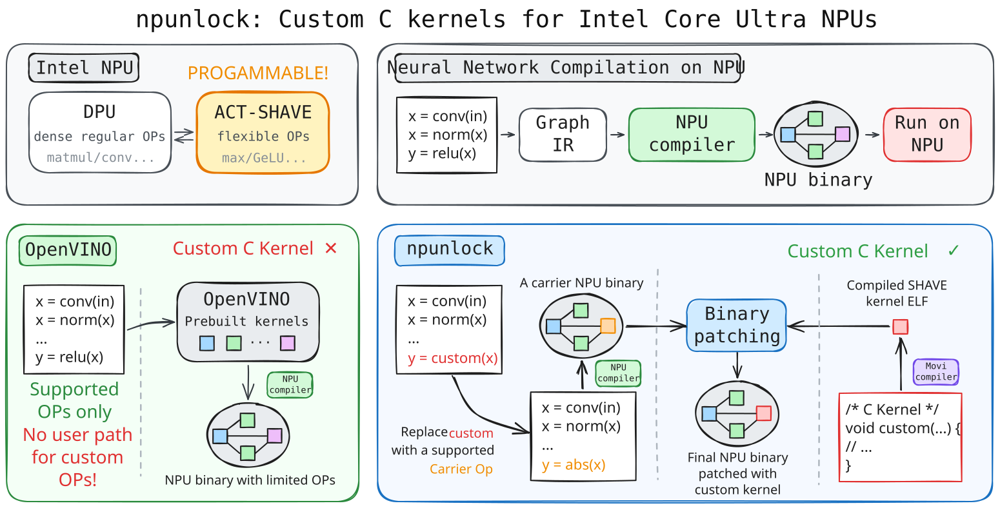

# npunlock

Intel ships programmable SHAVE cores inside its NPUs, but the public stack
exposes only graph-level programming. `npunlock` reconstructs the missing path
from custom C code to a runnable NPU kernel.



The current implementation has been verified on Windows x64 with Meteor Lake /
NPU3720.

> **Latest breakthrough — 2026-10-16:** A custom kernel can consume U8 and produce FP32 through an explicit `Convert` carrier, with exact NPU3720 output. [Evidence and limits](wiki/REVERSE_ENGINEERING.md#52-u8-to-fp32-custom-kernel-execution).

New to the project? Follow the [custom-kernel tutorial](wiki/TUTORIAL.md) from
a first FP16 loop through carrier selection, multi-input kernels, conversions,
and reusable deployment artifacts.

## Quick example

This complete FP32 GELU example embeds the C kernel in Python, places it in an
NPU graph, and checks the result against NumPy. The bundled
`npunlock/npu3720_kernel.h` target header supplies the NPU3720 invocation and
tensor-address helpers. MoviTools' math archive exposes familiar names without
requiring `<math.h>`; this example uses the execution-tested `tanhf` path.
Other archive entries remain candidates until tested on hardware. See the
[`mlibm.a` symbol inventory](ABI/MLIBM_SYMBOLS.md) for the observed candidates.

```python
import numpy as np
import npunlock as npu

npu.configure(movi_dll_dir=r"C:\path\to\MVC_DEPEND")

gelu_c: bytes = b"""
#define MLIBM_DEFINE_LINK_COMPAT 1
#include <npunlock/npu3720_kernel.h>

void controlled_act(unsigned layerParams) {
    act_abi_invocation invocation;
    ACT_ABI_LOAD_INVOCATION32_OR_RETURN(layerParams, invocation);
    const float *in = ACT_ABI_INPUT_PTR32(const float, invocation, 0u);
    float *out = ACT_ABI_OUTPUT_PTR32(float, invocation, 1u);
    const float SQRT_2_DIV_PI = 0.7978845608028654f;
    for (unsigned i = 0; i < invocation.element_count; ++i) {
        float x = in[i];
        float w = x + 0.044715f * x * x * x;
        w = tanhf(w * SQRT_2_DIV_PI);
        out[i] = 0.5f * x * (1.0f + w);
    }
}
"""

N = 2048
x = npu.input("x", shape=(1, N), dtype="f32")
y = npu.custom(
    x,
    source=gelu_c,
    carrier="Abs",
    _name="y",
)

program = npu.compile(npu.Graph(inputs=[x], outputs=[y], name="gelu_f32_example"))

input_value = np.linspace(-4, 4, N, dtype=np.float32).reshape(1, -1)
output = program.run_one(input_value)
reference = 0.5 * input_value * (
    1.0
    + np.tanh(
        np.sqrt(2.0 / np.pi)
        * (input_value + 0.044715 * input_value**3)
    )
)
print(f"maximum absolute error: {np.max(np.abs(output - reference)):g}")
```

The same code is available as the runnable
[FP32 GELU example](examples/example_gelu_f32.py). See also the
[FP16 GELU](examples/example_gelu.py) and
[multi-layer two-input](examples/example_multilayer_multi_input.py) examples,
plus a [row-broadcast two-input kernel](examples/example_broadcast_custom.py),
a [five-input kernel](examples/example_five_input_custom.py), and a
[mixed-precision graph with unary and binary custom branches](examples/example_mixed_precision_multi_custom.py)
and a
[branched network combining DPU work with three custom kernels](examples/example_branched_network.py).
The [connected conversion example](examples/example_conversion_kernels.py)
uses custom kernels on both sides of an ordinary FP16 graph operation.
The [connected mixed-precision example](examples/example_connected_mixed_precision.py)
adds a two-input custom kernel, DPU matrix multiplication, reviewed build plan,
prepared-carrier reload, and saved-program reload in one path.
The [I32 structural example](examples/example_i32_structural.py) needs no
MoviTools and demonstrates ordinary multi-input/multi-output `Concat`,
`Transpose`, and `Convert` execution.
The [I32 custom-kernel example](examples/example_i32_custom.py) compiles a
signed-integer affine loop and checks every result against NumPy.
The [binary I32 example](examples/example_i32_binary_custom.py) independently
uses both graph inputs in a non-commutative signed-integer kernel.
The [I8 custom-kernel example](examples/example_i8_custom.py) does the same for
one bounded signed-byte carrier.
The [binary I8 example](examples/example_i8_binary_custom.py) uses two
independent graph inputs while keeping every result in signed-byte range.
The [I16 custom-kernel example](examples/example_i16_custom.py) validates a
bounded signed-short affine kernel on the corresponding unary carrier.
The [binary I16 example](examples/example_i16_binary_custom.py) independently
uses both graph inputs in a non-commutative signed-short kernel.
The [U8-to-FP32 custom example](examples/example_u8_to_f32_custom.py) uses an
explicit mixed-precision `Convert` carrier and needs no manual output dtype.
The [U8 reshape example](examples/example_u8_reshape.py) likewise needs no
MoviTools and returns both reshaped U8 data and its FP32 conversion.
The [I8 axis-transform example](examples/example_i8_axes.py) covers signed-byte
`Squeeze`, `Unsqueeze`, and FP32 conversion in one ordinary graph.
The [I16 Split example](examples/example_i16_split.py) demonstrates one
multi-output node bound directly to three shared output arrays.
The [U16 Split example](examples/example_u16_split.py) covers unsigned 16-bit
boundary values, while the [U8 Gather example](examples/example_u8_gather.py)
uses caller-provided I32 indices in a mixed-input ordinary graph.
The [U32 Split example](examples/example_u32_split.py) extends ordinary graph
transport through the full unsigned 32-bit range.
The [I64-index Gather example](examples/example_u8_gather_i64.py) validates
64-bit index inputs without claiming general I64 graph data.
The [unequal U8 split example](examples/example_u8_variadic_split.py) binds
three differently shaped outputs from one `VariadicSplit` node. The
[U8 Slice example](examples/example_u8_slice.py) selects and strides two axes
using constant bounds, while the [U8 Pad example](examples/example_u8_pad.py)
adds constant borders with an exact scalar fill value.

## Why npunlock?

Intel's normal NPU software accepts graphs made from operations its compiler
supports; it does not expose a public workflow for supplying a C implementation
for an operation. The NPU's ACT-SHAVE processors are programmable and run
software kernels. `npunlock` makes those processors usable for compatible
custom graph operations while retaining Intel's compiler and driver for the
surrounding graph and hardware execution.

## Requirements

- Windows x64
- Meteor Lake / Intel NPU3720
- an installed Intel NPU driver for the device
- Python 3.10 or newer
- CMake 3.24 or newer and an installed MSVC toolchain for source installation
- the extracted MoviTools `MVC_DEPEND` toolchain for custom C compilation

OpenVINO is not required as a runtime, Python package, or compiler frontend.
`npunlock` does emit OpenVINO-format IR for the installed Intel driver.

## Install

`npunlock` is currently installed from a source checkout:

```powershell
python -m pip install .
```

The build bundles `npunlock.dll` and `npunlock_worker.exe` inside the Python
package, so normal Python use does not require a separate native path.

## Get MoviTools

Custom C compilation uses Intel/Movidius MoviTools, which `npunlock` does not
redistribute or download. 

A MoviTools package verified to work was found in a legacy Lenovo driver pack. See [Getting MoviTools](wiki/GET_MOVITOOLS.md) for the official download,
hash, extraction command, and expected layout. 

Extract the `MVC_DEPEND` payload from Lenovo's older
Intel NPU driver package `31.0.100.1688`, but remember, **DO NOT install or downgrade to
that driver**. All we need is the bundled MoviTools.

## Check your setup

After configuring `NPUNLOCK_MOVITOOLS_DIR`, inspect both runtime capabilities:

```powershell
python -m npunlock doctor
```

The report distinguishes running an already compiled program from compiling
new custom C, which additionally requires MoviTools. See the
[Python API guide](wiki/PYTHON_API.md#environment-diagnostics) for JSON and
offline options. Use `python -m npunlock doctor --full` when you explicitly
want an end-to-end custom-kernel compile, execution, and exact host-oracle
check.

## Run an example

Point `npunlock` at the extracted `MVC_DEPEND` root and run GELU:

```powershell
$env:NPUNLOCK_MOVITOOLS_DIR = 'C:\path\to\MVC_DEPEND'
python examples\example_gelu.py
```

The example runs on the NPU and reports its maximum error against a NumPy
reference.

## What currently works

- compile user-written C into ACT-SHAVE machine code
- run custom kernels inside Intel NPU graphs
- static dense FP16 unary and two-input custom kernels, including one validated descriptor-level row-broadcast carrier
- one static dense five-input FP16 carrier, including a fused local RMS/affine/gate kernel
- verified unary and scalar-input binary FP32 paths
- verified same-precision unary and equal-span two-input I32 custom-kernel paths
- verified same-precision unary and equal-span two-input I8 custom-kernel paths
- verified same-precision unary and equal-span two-input I16 custom-kernel paths
- a verified unary U8-input/FP32-output custom conversion path
- one graph containing independent FP32-unary and FP16-binary custom branches
- a branched graph combining ordinary ACT operations, DPU matrix multiplication, and three custom kernels
- prepared-graph inspection and explicit symbolic binding for ambiguous ACT placement
- connected unary FP32-to-FP16 and FP16-to-FP32 custom kernels through per-tensor contracts
- ordinary static graph execution with FP16, FP32, U8, I8, U16, I16, U32, or I32 inputs and outputs
- caller-provided I64 index inputs for validated `Gather` graphs
- inferred contracts for `Concat`, `Split`, `VariadicSplit`, constant-mode `Pad`, positive-step `Slice`, `Gather`, `Transpose`, `Reshape`, `Squeeze`, `Unsqueeze`, `Convert`, and rank-2 `MatMul`
- nonlinear math such as GELU, `tanhf`, `expf`, `sqrtf`, and invocation-local softmax
- bounded custom control flow, nested helpers, invocation-local windows/reductions, data-dependent loops, and local permutation
- validated dimension-driven indexing for one observed rank-4 invocation layout
- bounded runtime dispatch through same-file function pointers and an invocation-local table
- reusable NumPy-compatible host/NPU shared input and output buffers
- reusable compiled SHAVE ELFs for rebuilds that do not need MoviTools
- self-describing program bundles that load without C source or MoviTools
- Python, CLI, and native C APIs

## Current limitations

Support is experimental and currently limited to Windows x64, Meteor Lake /
NPU3720, static shapes, compatible ACT carriers, and known tensor layouts.
Connected FP32/FP16 conversion is limited to the observed unary, equal-element
contract and requires explicit prepared-group binding. The U8-input/FP32-output
custom path has the same explicit-binding requirement; same-precision U8 is not
supported. I32, I16, and I8 each have one equal-span two-input path; scalar and
unequal-span integer inputs are not supported.
Other NPU generations have not been verified. See
[Current limitations](wiki/LIMITATIONS.md) for the full compatibility boundary.

## Help test Linux and newer NPUs

Have an NPU3720 Linux system or a newer Intel NPU? Contributions are welcome.
Two routes look especially promising but remain untested:

- a patched NPU3720 graph produced on Windows may run on Linux because the NPU
  firmware executes the custom machine code; building SHAVE code on Linux would
  additionally require a way to load the Windows MoviTools DLLs;
- newer NPUs may execute the existing `3720xx` SHAVE image, or an older OEM
  driver package for that generation may provide matching MoviTools components.

Both need hardware validation, driver/firmware version records, and output
comparison against a host oracle. If you can test either path, feedback, failure
reports, and code contributions are welcome. See
[Porting to Linux and newer NPUs](wiki/PORTING.md) for the hypotheses, caveats,
and staged test plan. Linux builds provide `npunlock-inspect` for structural
reports and `npunlock-linux-probe` for an explicitly in-process execution
attempt with stage-by-stage diagnostics and an exact host oracle. The latter is
ready for hardware testing but has not yet run on a Linux system with NPU
passthrough, so Linux execution is not a supported configuration yet.

## Documentation

- **[Custom-kernel tutorial](wiki/TUTORIAL.md)** — write a first kernel, choose a compatible carrier, and grow to multi-input and mixed-precision graphs
- **[Getting MoviTools](wiki/GET_MOVITOOLS.md)** — obtain the compiler toolchain without installing the legacy driver
- **[Python API](wiki/PYTHON_API.md)** — construct, compile, and execute graphs from Python
- **[Writing custom kernels](wiki/CUSTOM_KERNELS.md)** — C entry point, tensor contract, and examples
- **[How npunlock works](wiki/HOW_NPUNLOCK_WORKS.md)** — graph compilation and custom-kernel integration
- **[Reverse-engineering breakthroughs](wiki/REVERSE_ENGINEERING.md)** — the experiments and discoveries that made custom kernels possible
- **[From model to machine code](wiki/MODEL_TO_MACHINE_CODE.md)** — step-by-step lowering and the components involved
- **[Intel NPU architecture](wiki/INTEL_NPU_ARCHITECTURE.md)** — DPU and ACT-SHAVE overview
- **[Current limitations](wiki/LIMITATIONS.md)** — verified hardware and ABI scope
- **[Porting to Linux and newer NPUs](wiki/PORTING.md)** — experimental routes and contribution guide
- **[Porting probe bundle](wiki/PORTING_PROBE_BUNDLE.md)** — reproducible graph, tensor, provenance, and oracle package
- **[Development and native APIs](wiki/DEVELOPMENT.md)** — CMake, testing, packaging, CLI, and C interfaces
- **[Full documentation index](wiki/README.md)**

> [!WARNING]
> **A note on AI use:** I did use AI while building this project--for scaffolding, repetitive implementation work, converting my reverse-engineered results into organized documentation, and fixing my English. The reverse engineering, experiments, debugging, and technical conclusions came from hands-on work. If that doesn’t bother you, there’s a pretty deep and surprisingly satisfying rabbit hole ahead.

## License

`npunlock` is licensed under the [Apache License 2.0](LICENSE). MoviTools and
the Intel/Movidius libraries are external proprietary dependencies and are not
covered or redistributed by this repository.
